# SpendSync

 **A full-stack personal finance tracker** — track income & expenses, visualise spending trends, export reports, and stay in control of your money.

**Live Demo:** [https://spend-sync-gamma.vercel.app/](https://spend-sync-gamma.vercel.app/)

---

## Features

| Feature | Description |
|---|---|
|**JWT Authentication** | Register / Login with secure bcrypt-hashed passwords and stateless JWT tokens |
|**Dashboard** | Monthly income vs expense bar chart, net balance, category breakdown (Recharts) |
|**Transactions** | Add, edit, delete income & expense records with category, date, notes, and amount |
|**Search & Filter** | Real-time search by description / category / amount; filter by type, category, date range |
|**Categories** | Pre-built income & expense categories with emoji icons and spending breakdown |
|**PDF Export** | Download a formatted financial statement PDF via jsPDF + jspdf-autotable |
|**CSV Export** | Export filtered transactions as a CSV file |
|**Multi-currency** | Per-user currency preference stored in profile |
|**Email Reports** | Backend email report service (Spring Mail) |
|**Offline Fallback** | When the backend is unreachable, auth and transactions fall back to localStorage vault |
|**Responsive UI** | Fully responsive dark-theme UI — works on mobile, tablet, and desktop |

---

## Architecture

```mermaid

flowchart TD

subgraph group_client["Browser application"]
  node_routes["App routes<br/>[App.jsx]"]
  node_auth_pages["Sign-in and signup<br/>[LoginPage.jsx]"]
  node_api_client["Axios API client<br/>[client.js]"]
end

subgraph group_auth["Identity and access"]
  node_auth_store["Auth state and vault<br/>[authStore.js]"]
  node_auth_controller["Auth endpoints"]
  node_auth_service["Auth service<br/>[AuthService.java]"]
  node_security["JWT security"]
  node_user_details["User details lookup"]
  node_jwt_provider["JWT provider"]
end

subgraph group_finance["Finance workflows"]
  node_dashboard["Dashboard<br/>[DashboardPage.jsx]"]
  node_transactions_page["Transaction ledger"]
  node_categories_page["Categories view<br/>[CategoriesPage.jsx]"]
  node_analytics_page["Analytics view<br/>[AnalyticsPage.jsx]"]
  node_export_page["Report export<br/>[ExportPage.jsx]"]
  node_settings_page["Profile settings<br/>[SettingsPage.jsx]"]
  node_transaction_store["Transaction state"]
  node_pdf["PDF generator<br/>[pdfExport.js]"]
end

subgraph group_backend["Spring API"]
  node_transaction_controller["Transaction endpoints"]
  node_transaction_service["Transaction logic"]
end

subgraph group_data["Persistence and integrations"]
  node_user_repository["User repository"]
  node_transaction_repository["Transaction repository"]
  node_users_db[("User documents<br/>[User.java]")]
  node_transactions_db[("Transaction documents<br/>[Transaction.java]")]
  node_email_reports["Email reports"]
end

node_user(("Finance user"))
node_email_service["Mail provider"]

node_user -->|"uses"| node_routes
node_routes -->|"routes to"| node_auth_pages
node_routes -->|"routes to"| node_dashboard
node_routes -->|"routes to"| node_transactions_page
node_routes -->|"routes to"| node_categories_page
node_routes -->|"routes to"| node_analytics_page
node_routes -->|"routes to"| node_export_page
node_routes -->|"routes to"| node_settings_page
node_auth_pages -.->|"uses auth"| node_auth_store
node_dashboard -->|"reads summary"| node_transaction_store
node_transactions_page -->|"manages records"| node_transaction_store
node_categories_page -.->|"reads records"| node_transaction_store
node_analytics_page -.->|"reads records"| node_transaction_store
node_export_page -->|"exports records"| node_transaction_store
node_export_page -->|"generates PDF"| node_pdf
node_settings_page -.->|"reads profile"| node_auth_store
node_auth_store -->|"calls auth API"| node_api_client
node_transaction_store -->|"calls transaction API"| node_api_client
node_transaction_store -->|"checks vault mode"| node_auth_store
node_api_client -->|"sends auth requests"| node_auth_controller
node_api_client -->|"sends finance requests"| node_transaction_controller
node_auth_controller -->|"delegates"| node_auth_service
node_auth_service -->|"reads and saves users"| node_user_repository
node_auth_service -->|"creates tokens"| node_jwt_provider
node_security -->|"validates tokens"| node_jwt_provider
node_security -->|"loads identity"| node_user_details
node_user_details -->|"looks up user"| node_user_repository
node_transaction_controller -->|"delegates"| node_transaction_service
node_transaction_controller -->|"resolves user ID"| node_user_repository
node_transaction_service -->|"queries records"| node_transaction_repository
node_transaction_service -->|"validates user"| node_user_repository
node_user_repository -->|"persists users"| node_users_db
node_transaction_repository -->|"persists records"| node_transactions_db
node_email_reports -.->|"sends reports"| node_email_service

click node_routes "https://github.com/piyushfunde/spendsync/blob/main/client/src/App.jsx"
click node_auth_pages "https://github.com/piyushfunde/spendsync/blob/main/client/src/pages/LoginPage.jsx"
click node_dashboard "https://github.com/piyushfunde/spendsync/blob/main/client/src/pages/DashboardPage.jsx"
click node_transactions_page "https://github.com/piyushfunde/spendsync/blob/main/client/src/pages/TransactionsPage.jsx"
click node_categories_page "https://github.com/piyushfunde/spendsync/blob/main/client/src/pages/CategoriesPage.jsx"
click node_analytics_page "https://github.com/piyushfunde/spendsync/blob/main/client/src/pages/AnalyticsPage.jsx"
click node_export_page "https://github.com/piyushfunde/spendsync/blob/main/client/src/pages/ExportPage.jsx"
click node_settings_page "https://github.com/piyushfunde/spendsync/blob/main/client/src/pages/SettingsPage.jsx"
click node_auth_store "https://github.com/piyushfunde/spendsync/blob/main/client/src/store/authStore.js"
click node_transaction_store "https://github.com/piyushfunde/spendsync/blob/main/client/src/store/transactionStore.js"
click node_api_client "https://github.com/piyushfunde/spendsync/blob/main/client/src/api/client.js"
click node_pdf "https://github.com/piyushfunde/spendsync/blob/main/client/src/utils/pdfExport.js"
click node_auth_controller "https://github.com/piyushfunde/spendsync/blob/main/server/src/main/java/com/spendsync/api/controller/AuthController.java"
click node_auth_service "https://github.com/piyushfunde/spendsync/blob/main/server/src/main/java/com/spendsync/api/service/AuthService.java"
click node_security "https://github.com/piyushfunde/spendsync/blob/main/server/src/main/java/com/spendsync/api/security/JwtAuthenticationFilter.java"
click node_user_details "https://github.com/piyushfunde/spendsync/blob/main/server/src/main/java/com/spendsync/api/security/CustomUserDetailsService.java"
click node_jwt_provider "https://github.com/piyushfunde/spendsync/blob/main/server/src/main/java/com/spendsync/api/security/JwtTokenProvider.java"
click node_transaction_controller "https://github.com/piyushfunde/spendsync/blob/main/server/src/main/java/com/spendsync/api/controller/TransactionController.java"
click node_transaction_service "https://github.com/piyushfunde/spendsync/blob/main/server/src/main/java/com/spendsync/api/service/TransactionService.java"
click node_user_repository "https://github.com/piyushfunde/spendsync/blob/main/server/src/main/java/com/spendsync/api/repository/UserRepository.java"
click node_transaction_repository "https://github.com/piyushfunde/spendsync/blob/main/server/src/main/java/com/spendsync/api/repository/TransactionRepository.java"
click node_users_db "https://github.com/piyushfunde/spendsync/blob/main/server/src/main/java/com/spendsync/api/model/User.java"
click node_transactions_db "https://github.com/piyushfunde/spendsync/blob/main/server/src/main/java/com/spendsync/api/model/Transaction.java"
click node_email_reports "https://github.com/piyushfunde/spendsync/blob/main/server/src/main/java/com/spendsync/api/service/EmailReportService.java"

classDef toneNeutral fill:#f8fafc,stroke:#334155,stroke-width:1.5px,color:#0f172a
classDef toneBlue fill:#dbeafe,stroke:#2563eb,stroke-width:1.5px,color:#172554
classDef toneAmber fill:#fef3c7,stroke:#d97706,stroke-width:1.5px,color:#78350f
classDef toneMint fill:#dcfce7,stroke:#16a34a,stroke-width:1.5px,color:#14532d
classDef toneRose fill:#ffe4e6,stroke:#e11d48,stroke-width:1.5px,color:#881337
classDef toneIndigo fill:#e0e7ff,stroke:#4f46e5,stroke-width:1.5px,color:#312e81
classDef toneTeal fill:#ccfbf1,stroke:#0f766e,stroke-width:1.5px,color:#134e4a
class node_routes,node_auth_pages,node_api_client,node_user toneBlue
class node_auth_store,node_auth_controller,node_auth_service,node_security,node_user_details,node_jwt_provider toneAmber
class node_dashboard,node_transactions_page,node_categories_page,node_analytics_page,node_export_page,node_settings_page,node_transaction_store,node_pdf toneMint
class node_transaction_controller,node_transaction_service toneRose
class node_user_repository,node_transaction_repository,node_users_db,node_transactions_db,node_email_reports,node_email_service toneIndigo
```



### Request Flow

```
User → React Page → Zustand Store → Axios Client
     → Spring Security (JWT filter)
     → Controller → Service → Repository → MongoDB
     → JSON Response → Store → React re-render
```

---

## Tech Stack

### Frontend
| Technology | Version | Purpose |
|---|---|---|
| **React** | 19.x | UI framework |
| **Vite** | 8.x | Build tool & dev server |
| **Tailwind CSS** | 4.x | Utility-first styling |
| **Zustand** | 5.x | Global state management |
| **React Router** | 7.x | Client-side routing |
| **Recharts** | 3.x | Charts & data visualisation |
| **Axios** | 1.x | HTTP client |
| **Lucide React** | latest | Icon library |
| **jsPDF** | 4.x | PDF generation |
| **jspdf-autotable** | 5.x | Table layout in PDFs |
| **react-csv** | 2.x | CSV export |
| **react-hot-toast** | 2.x | Toast notifications |
| **date-fns** | 4.x | Date formatting helpers |

### Backend
| Technology | Version | Purpose |
|---|---|---|
| **Java** | 17 | Language |
| **Spring Boot** | 3.2.5 | Application framework |
| **Spring Security** | 6.x | Authentication & authorisation |
| **Spring Data MongoDB** | 4.x | Database ORM |
| **Spring Mail** | 3.x | Email report service |
| **jjwt (JJWT)** | 0.12.5 | JWT creation & validation |
| **Lombok** | latest | Boilerplate reduction |
| **Apache Commons CSV** | 1.10.0 | CSV processing |
| **Maven** | 3.x | Build & dependency management |

### Infrastructure
| Service | Purpose |
|---|---|
| **MongoDB Atlas** | Cloud database (M0 Free Tier) |
| **Render** | Backend hosting (Docker container) |
| **Vercel / Render Static** | Frontend hosting |
| **Docker** | Containerisation |
| **Docker Compose** | Local multi-service orchestration |

---

## Project Structure

```
SpendSync/
├── client/                          # React frontend
│   ├── public/
│   │   ├── favicon.svg
│   │   ├── manifest.json            # PWA manifest
│   │   └── _redirects               # Netlify SPA fallback
│   ├── src/
│   │   ├── api/
│   │   │   └── client.js            # Axios instance (env-aware base URL)
│   │   ├── components/
│   │   │   ├── AuthLayout.jsx       # Auth page wrapper
│   │   │   ├── Header.jsx           # Top navigation bar
│   │   │   ├── ProtectedRoute.jsx   # JWT-guarded route wrapper
│   │   │   ├── RequestError.jsx     # Reusable error banner
│   │   │   ├── Reveal.jsx           # Scroll-reveal animation
│   │   │   ├── Sidebar.jsx          # Left navigation sidebar
│   │   │   ├── TransactionItem.jsx  # Single transaction row
│   │   │   └── TransactionModal.jsx # Add / edit transaction modal
│   │   ├── pages/
│   │   │   ├── LandingPage.jsx      # Public marketing page
│   │   │   ├── LoginPage.jsx        # Sign-in form
│   │   │   ├── RegisterPage.jsx     # Sign-up form
│   │   │   ├── DashboardPage.jsx    # Overview charts & KPI cards
│   │   │   ├── TransactionsPage.jsx # Full transaction ledger
│   │   │   ├── CategoriesPage.jsx   # Spending by category
│   │   │   ├── AnalyticsPage.jsx    # Trend charts & analytics
│   │   │   ├── ExportPage.jsx       # PDF / CSV export
│   │   │   └── SettingsPage.jsx     # Profile & preferences
│   │   ├── store/
│   │   │   ├── authStore.js         # Zustand auth state + offline vault
│   │   │   └── transactionStore.js  # Zustand transactions + localStorage CRUD
│   │   ├── utils/
│   │   │   ├── constants.js         # Categories, formatCurrency, helpers
│   │   │   └── pdfExport.js         # jsPDF financial statement generator
│   │   ├── App.jsx                  # Route definitions
│   │   ├── main.jsx                 # React entry point
│   │   └── index.css                # Global dark theme styles
│   ├── .env                         # VITE_API_BASE_URL (not committed)
│   ├── vercel.json                  # Vercel SPA rewrite rules
│   ├── vite.config.js               # Vite + Tailwind plugin
│   ├── nginx.conf                   # Nginx config for Docker
│   └── Dockerfile                   # Frontend Docker image
│
├── server/                          # Spring Boot backend
│   └── src/main/java/com/spendsync/api/
│       ├── SpendSyncApplication.java          # Main entry point
│       ├── config/
│       │   └── SecurityConfig.java            # CORS, JWT filter, security chain
│       ├── controller/
│       │   ├── AuthController.java            # POST /api/auth/register, /login
│       │   └── TransactionController.java     # CRUD /api/transactions, dashboard
│       ├── dto/
│       │   ├── LoginRequest.java
│       │   ├── RegisterRequest.java
│       │   ├── TransactionRequest.java
│       │   ├── AuthResponse.java
│       │   ├── TransactionResponse.java
│       │   └── DashboardSummaryResponse.java
│       ├── exception/
│       │   ├── BadRequestException.java
│       │   ├── ResourceNotFoundException.java
│       │   └── GlobalExceptionHandler.java    # @ControllerAdvice error handler
│       ├── model/
│       │   ├── User.java                      # MongoDB document
│       │   └── Transaction.java               # MongoDB document
│       ├── repository/
│       │   ├── UserRepository.java
│       │   └── TransactionRepository.java
│       ├── security/
│       │   ├── JwtTokenProvider.java          # Sign & validate JWT
│       │   ├── JwtAuthenticationFilter.java   # Per-request JWT filter
│       │   └── CustomUserDetailsService.java
│       └── service/
│           ├── AuthService.java               # Register, login logic
│           ├── TransactionService.java        # Business logic, dashboard calc
│           └── EmailReportService.java        # Email report sender
│   └── src/main/resources/
│       └── application.yml                    # App config (port, MongoDB, JWT, CORS)
│   ├── .env                                   # Server secrets (not committed)
│   ├── Dockerfile                             # Backend Docker image
│   └── pom.xml                                # Maven dependencies
│
├── docker-compose.yml               # Run frontend + backend locally with Docker
├── .env.example                     # Template for environment variables
├── .gitignore
└── README.md
```

---

## API Endpoints

### Auth — `/api/auth`
| Method | Endpoint | Description | Auth |
|---|---|---|---|
| `POST` | `/api/auth/register` | Create a new account | Public |
| `POST` | `/api/auth/login` | Sign in, returns JWT token | Public |

### Transactions — `/api/transactions`
| Method | Endpoint | Description | Auth |
|---|---|---|---|
| `GET` | `/api/transactions` | List all transactions (with optional filters) | JWT |
| `POST` | `/api/transactions` | Create a new transaction |  JWT |
| `PUT` | `/api/transactions/{id}` | Update a transaction |  JWT |
| `DELETE` | `/api/transactions/{id}` | Delete a transaction |  JWT |
| `GET` | `/api/transactions/dashboard` | Monthly summary + KPI data |  JWT |
| `GET` | `/api/transactions/export/csv` | Download transactions as CSV |  JWT |

---

##  Environment Variables

### Client (`client/.env`)
```env
VITE_API_BASE_URL=https://spendsync-9si7.onrender.com
```

### Server (`server/.env`)
```env
MONGODB_URI=mongodb+srv://<user>:<password>@cluster0.xxx.mongodb.net/spendsync
JWT_SECRET=your-256-bit-secret
JWT_EXPIRATION=86400000
ALLOWED_ORIGINS=https://your-frontend.vercel.app
MAIL_USERNAME=your@email.com
MAIL_PASSWORD=your-app-password
```

> See [`.env.example`](.env.example) for the full template.

---

##  Running Tests

```bash
# Frontend unit tests (Vitest)
cd client
npm test

# Backend tests (JUnit)
cd server
mvn test
```

---

## Contributing

1. Fork the repo
2. Create a feature branch: `git checkout -b feature/your-feature`
3. Commit changes: `git commit -m "feat: add your feature"`
4. Push: `git push origin feature/your-feature`
5. Open a Pull Request

---

